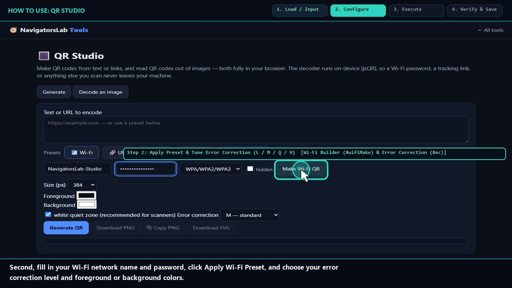
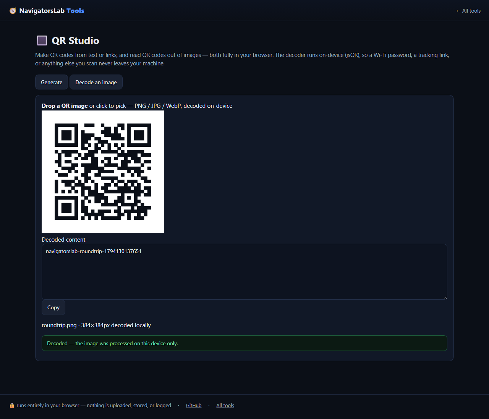

# 🔳 QR Studio

> Generate QR codes and decode QR images — no site sees them

     

<h4 align="center">
  &#9654; <a href="https://navigatorslab.com/tools/qr.html">Open it on navigatorslab.com</a> &mdash; free, no sign-up, nothing uploaded<br>
  <a href="https://navigatorslab.com/QR-Studio">navigatorslab.com/QR-Studio</a> &middot; <a href="https://navigatorslab.com/tools/videos/qr.mp4">🔊 Watch Narrated Step-by-Step Tutorial Video</a> &middot; <a href="https://navigatorslab.com/tools/videos/notebooklm-overview.mp4">Watch Full Suite Hands-On Video</a><br>
  This repo's Pages site runs the <em>actual tool</em>: <code>demo.html</code>
</h4>



Generate and decode with presets for Wi-Fi (escaped SSID/password), URL, email, phone and contact cards — plus selectable error correction.

## 📖 Complete Step-by-Step User Guide

### Step 1: Type Text/URL or Pick Wi-Fi, vCard, or Email Preset (`Payload Input (#qrText) & Presets (#preWifi)`)
- **How to do it:** Enter any URL or text into `#qrText`, or click a structured preset button (**Wi-Fi `#preWifi`**, **vCard**, **Email**, **SMS**) to open its dedicated fields.
- **Expected result:** Structured payload fields appear (and special characters like `;` and `\` in Wi-Fi passwords are escaped automatically).

### Step 2: Apply Preset & Tune Error Correction (L / M / Q / H) (`Wi-Fi Builder (#wifiMake) & Error Correction (#ec)`)
- **How to do it:** Fill the preset fields (e.g., SSID `#wifiS` and Password `#wifiP`), click **Apply (`#wifiMake`)**, select Error Correction (`L`, `M`, `Q`, or `H`), and click **Generate QR (`#qrMake`)**.
- **Expected result:** Crisp QR matrix renders immediately with module count and error-correction metadata (`#qrMeta`).

### Step 3: Export Crisp Vector SVG or High-DPI PNG (`Export PNG (#qrPng) & SVG (#qrSvg)`)
- **How to do it:** Click **Download PNG (`#qrPng`)** for digital use or **Download SVG (`#qrSvg`)** for vector print layout in Illustrator, Figma, or InDesign.
- **Expected result:** Direct-payload PNG or vector SVG saved locally (never expires, zero bit.ly/redirect middlemen).

### Step 4: Switch to Decode Tab to Read Any QR Image Locally (`Decode Tab (#tabRead) & QR Dropzone (#qrDz)`)
- **How to do it:** Click **Decode QR (`#tabRead`)** and drop an image or paste a screenshot (`Ctrl+V`) onto `#qrDz`. `jsQR` decodes the raw payload string into `#qrData`.
- **Expected result:** Inspect suspicious QR codes safely without opening untrusted URLs on your phone.

## 🎛️ UI Controls, Shortcuts & Parameters Reference

| Control / Shortcut | What It Does |
|---|---|
| `Payload Box (`#qrText`) & Generate (`#qrMake`)` | Encodes any text, URL, or preset string into a QR matrix. |
| `Presets (`#preWifi`, vCard, Email)` | Builds standards-compliant `WIFI:T:WPA;...` and `BEGIN:VCARD` payloads with RFC escaping. |
| `Export PNG (`#qrPng`) & SVG (`#qrSvg`)` | Saves high-resolution raster PNG or true vector SVG files. |
| `Decode Tab (`#tabRead` + `#qrDz`)` | Decodes QR images locally via bundled `jsQR` without a camera or network request. |

## 💡 Pro Tips & Real-World Workflows

- 💡 Always choose **SVG** when sending a QR code to a print shop for flyers, business cards, or banners so the module edges stay razor-sharp at any size.
- 💡 Use Error Correction level **Q (25%)** or **H (30%)** for printed stickers outdoors so the code still scans even if scratched or smudged.
- 💡 You can deep-link directly to a generated QR code via URL parameters: `qr.html?text=https://navigatorslab.com&ec=H`.

## 🧪 Concrete Example: Input → Engine → Output

| Stage | What Happens | Details |
|---|---|---|
| **1. Raw Input** | **Office Wi-Fi Credentials / vCard / URL** | SSID: 'NavLab-Guest', Pass: 'ultra-secret!2026', WPA2 — or drop a screenshot of an unknown QR code |
| **2. On-Device Engine** | **Spec-escaped WIFI:S:... payload encoded via qrcode-generator (EC Level M/H) or decoded locally via bundled jsQR** | Runs 100% client-side in your browser tab under strict `CSP` (`connect-src 'none'`). |
| **3. Verified Output** | **wifi-qr.svg (Vector) & wifi-qr.png** | Crisp vector SVG + PNG with custom palette & quiet zone; encode → export → decode round-trip 100% verified |

```text
Payload: WIFI:T:WPA;S:NavLab-Guest;P:ultra-secret\!2026;; | Round-trip decode: EXACT [OK]
```

- 🔊 **Narrated Step-by-Step Usage Tutorial Video (`38s`):** [`demo.mp4`](./demo.mp4) (also live at [`https://navigatorslab.com/tools/videos/qr.mp4`](https://navigatorslab.com/tools/videos/qr.mp4))
- 🎬 **Full Suite Hands-On Video Guide:** [`https://navigatorslab.com/tools/videos/notebooklm-overview.mp4`](https://navigatorslab.com/tools/videos/notebooklm-overview.mp4)

## ✅ What it does

- Generate QR codes with Wi-Fi (spec-escaped), URL, email, phone and vCard presets
- Selectable error-correction, custom colors, spec quiet zone; PNG + vector SVG export
- Decode QRs from images too — nothing is sent anywhere

## 🚀 Try it in 30 seconds

1. Type text or pick the Wi-Fi / URL / vCard preset
2. Tune colors and error correction
3. Export PNG or SVG — or decode an existing QR image

## 📸 Live UI in action



## 🔒 Private by design

- **100% on-device** — files are processed in your browser and **never uploaded** to any server
- **No accounts, no tracking, no cookies, nothing retained** — open the page and work
- **Works offline** once loaded; fully mobile-friendly
- **Free & open source (MIT)** — use it at home, at work, anywhere

## 🤖 Built for humans *and* AI agents

- Deep-linkable via URL parameters — see the [Agent Mode guide](https://navigatorslab.com/tools/agents.html)
- Machine-readable catalog: [llms.txt](https://navigatorslab.com/tools/llms.txt) · [llms-full.txt](https://navigatorslab.com/tools/llms-full.txt)
- MCP endpoint: `POST https://navigatorslab.com/tools/mcp` (tool catalog + deterministic text tools — see the [main repo](https://github.com/Kayforkind/NavigatorsLab-Tools))
- No build step required to *use* any tool — just the URL

## 🛠 Under the hood

qrcode-generator + jsQR, both bundled — no network at all

Third-party components are catalogued in [NOTICE](NOTICE); this repo is MIT-licensed ([LICENSE](LICENSE)).

## 🗂 The NavigatorsLab Tools suite

The full catalog — every tool in the hub with the same zero-upload promise, plus the lab's apps, CLIs and engines:

| Tool | What it does | |
|---|---|---|
| 🛡 Photo Privacy Kit | Strip GPS, camera model and timestamps before posting | [Open](https://navigatorslab.com/tools/exif.html) |
| 🔐 Password Breach Checker | Has this password been breached? — it never leaves your tab | [Open](https://navigatorslab.com/tools/breachcheck.html) |
| 🔍 Metadata & Hidden-Data Checker | See what's really inside a file — then strip it | [Open](https://navigatorslab.com/tools/metadata.html) |
| 🗜 Image Shrinker | Hit “max 2 MB” portal limits without TinyPNG | [Open](https://navigatorslab.com/tools/shrink.html) |
| 📄 Scan & Screenshot Cleaner | Phone photos of documents → clean, straight PDFs | [Open](https://navigatorslab.com/tools/scan.html) |
| ✍ Local E-Sign Pad | Sign this lease tonight — not DocuSign | [Open](https://navigatorslab.com/tools/sign.html) |
| 🧾 Receipts → One PDF | Shoebox of receipt photos → one date-sorted PDF | [Open](https://navigatorslab.com/tools/receipts.html) |
| 🔢 Receipt OCR → CSV | Read totals off receipt photos, export for expenses | [Open](https://navigatorslab.com/tools/ocr.html) |
| **🔳 QR Studio** | Generate QR codes and decode QR images — no site sees them | [Open](https://navigatorslab.com/tools/qr.html) |
| 🎧 Audio Trimmer | Cut voice notes and clips on a waveform | [Open](https://navigatorslab.com/tools/audio.html) |
| 🧮 Invoice / Quote Generator | One-person shops: hours in, clean PDF out | [Open](https://navigatorslab.com/tools/invoice.html) |
| 🗂 Batch Rename & Sort | IMG_5847.jpg → 2026-09-05-receipt-home-depot.jpg | [Open](https://navigatorslab.com/tools/rename.html) |
| 🖨 Print-Shop Prep | Exact sizes, bleed, DPI checks, print-ready PDF | [Open](https://navigatorslab.com/tools/printprep.html) |
| 📑 PDF Pages | Reorder, rotate, delete and extract PDF pages | [Open](https://navigatorslab.com/tools/pdfpages.html) |
| 🔬 Text Diff | Compare two texts with word-level highlights | [Open](https://navigatorslab.com/tools/textdiff.html) |
| 🎨 Reimagine | Redesign any HTML page from its own content | [Open](https://navigatorslab.com/reimagine/) |
| 📊 Text Stats | Words, reading time, readability, keyword density | [Open](https://navigatorslab.com/tools/textstats.html) |
| 📜 PDF Studio | Edit the text inside your PDF — private, free, open source | [Open](https://navigatorslab.com/pdf-studio/) |
| 🩺 Design Health | 18 deterministic design-quality checks for HTML — no LLM, no API key | [Open](https://github.com/Kayforkind/design-health-action) |
| 🔪 Skill Slice | Copy one Read-verified skill folder — a slice, not the pie | [Open](https://github.com/Kayforkind/skill-slice) |
| 🕵 liecatchers | Your agent said Done. Prove it — ten sensors, one RECEIPT.json | [Open](https://github.com/Kayforkind/liecatchers) |
| 📚 Book Guide MCP | Ship improvements with your books — agents cite, run playbooks, learn | [Open](https://github.com/Kayforkind/book-guide-mcp) |
| 📡 Data Insights | Founder intelligence — daily & weekly tech signal briefs | [Open](https://github.com/Kayforkind/data-insights) |
| 🪓 Iron Axe: Legacy | An original side-scrolling beat 'em up — Godot 4 | [Open](https://github.com/Kayforkind/iron-axe-legacy) |

---

<p align="center">
  <b>One hub, twenty-four projects:</b> <a href="https://navigatorslab.com/tools/">https://navigatorslab.com/tools</a><br>
  <b>Source &amp; the whole suite:</b> <a href="https://github.com/Kayforkind/NavigatorsLab-Tools">https://github.com/Kayforkind/NavigatorsLab-Tools</a>
</p>
